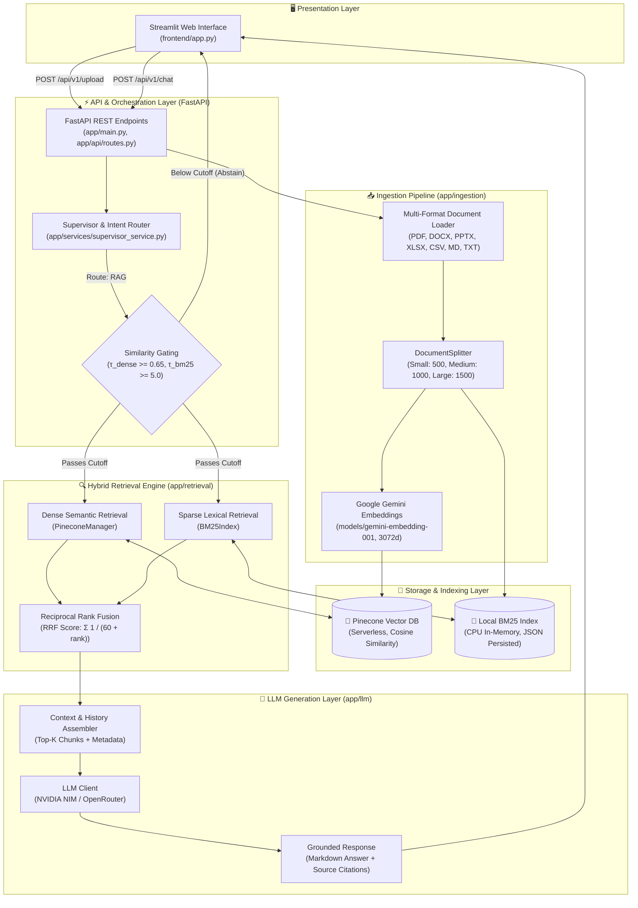

# 📖 TYRION-2.0: Complete Architecture, Working & Feature Documentation

> **Academic Capstone: Industrial Knowledge Intelligence & Decision Support System**  
> Built with **FastAPI**, **LangChain**, **Pinecone**, **Google Generative AI**, **NVIDIA NIM / OpenRouter**, and **Streamlit**.

---

## 📑 Table of Contents
1. [System Overview](#-system-overview)
2. [End-to-End Workflow Architecture](#-end-to-end-workflow-architecture)
3. [Key Features & Capabilities Built](#-key-features--capabilities-built)
   - [1. Multi-Format Ingestion Engine](#1-multi-format-ingestion-engine)
   - [2. Free Local PDF Extractor (No Cloud Dependency)](#2-free-local-pdf-extractor-no-cloud-dependency)
   - [3. Vector Store & Embedding Integration](#3-vector-store--embedding-integration)
   - [4. Intelligent Supervisor Query Router](#4-intelligent-supervisor-query-router)
   - [5. Evaluative & Hiring Recommendation Engine](#5-evaluative--hiring-recommendation-engine)
   - [6. Adaptive Similarity Thresholding & Query Expansion](#6-adaptive-similarity-thresholding--query-expansion)
   - [7. Conversational Greeting Service](#7-conversational-greeting-service)
   - [8. Safety Guardrails & Dynamic Out-of-Scope Override](#8-safety-guardrails--dynamic-out-of-scope-override)
   - [9. Interactive Streamlit Web UI](#9-interactive-streamlit-web-ui)
4. [Bugs Identified & Fixed](#-bugs-identified--fixed)
5. [Environment Configuration Reference](#-environment-configuration-reference)
6. [API Endpoints Reference](#-api-endpoints-reference)
7. [Running the Application](#-running-the-application)

---

## 🌟 System Overview

**TYRION-2.0** is designed to provide high-accuracy, hallucination-resistant question answering over diverse user documents (resumes, financial reports, technical manuals, research papers, datasets). 

Instead of passing raw questions blindly to an LLM, TYRION-2.0 employs a **multi-tiered agentic pipeline**:
- **Supervisor Routing**: Distinguishes greetings, guardrail violations, out-of-scope questions, and genuine document queries.
- **Dynamic Semantic Retrieval**: Matches questions against high-dimensional dense vector embeddings in Pinecone.
- **Adaptive Evaluation**: Capable of both literal extraction (*"What is the CGPA?"*) and high-level reasoning / synthesis (*"Should I hire him?"*).

---

## 🏗️ End-to-End Workflow Architecture



---

## 🚀 Key Features & Capabilities Built

### 1. Multi-Format Ingestion Engine
TYRION-2.0 supports seamless extraction from a wide array of document formats:
- **PDF Documents** (`.pdf`)
- **Word & PowerPoint** (`.docx`, `.pptx`)
- **Tabular Data** (`.csv`, `.xlsx`)
- **Plain & Formatted Text** (`.txt`, `.md`)
- **Image Formats with OCR & Vision** (`.png`, `.jpg`, `.jpeg`, `.tiff`, `.tif`, `.bmp`, `.webp`)

Each document is chunked with metadata tags (`source`, `page`, `slide_number`, `sheet_name`, `cell_anchor`, `image_index`, `extraction_method`, `doc_type`, `document_id`, `chunk_id`, `chunk_index`) to preserve full hierarchical provenance.

### 2. Multimodal Vision & Image Understanding Architecture
TYRION-2.0 integrates an enterprise-grade multimodal perception engine that ingests, sanitizes, inspects, and indexes visual engineering media:
- **Supported Visual Media**: Standalone image files (`.png`, `.jpg`, `.jpeg`, `.webp`, `.bmp`, `.tiff`, `.tif`) and embedded graphics inside PDF, DOCX, PPTX, and XLSX files.
- **Security & Preprocessing Pipeline (`app/vision/preprocessor.py`)**:
  - *Magic Byte Signature Verification*: Validates file header signatures before decoding, rejecting disguised executables or scripts.
  - *Decompression Bomb Protection*: Configures strict pixel limits (`IMAGE_MAX_PIXELS = 25,000,000`) to prevent memory exhaustion from zip bomb images.
  - *EXIF Transpose Correction*: Automatically detects camera orientation tags and rotates images upright.
  - *Multi-Frame TIFF Unpacking*: Extracts and processes multi-page TIFF frames sequentially.
  - *Proportional Downscaling*: High-resolution images exceeding 2048px on their longest edge are downscaled using high-fidelity Lanczos resampling while preserving exact aspect ratios.
- **Vision Providers & JSON Contract (`app/vision/client.py`, `app/schemas/vision.py`)**:
  - *Google Gemini Vision (`gemini-3.5-flash-lite`)*: Free-tier vision provider extracting OCR text, scene descriptions, detected objects, technical tags/serial numbers, Markdown tables, chart trends, and P&ID schematic components. Enforced through strict Pydantic schemas (`VisionModelOutput`).
  - *Prompt Injection Defense*: Embedded system prompting instructs the vision model to treat all visible text purely as passive data to transcribe, immunizing against prompt injection instructions contained within images.
  - *Local OCR Fallback (`LocalOcrProvider`)*: When cloud vision is disabled (`ALLOW_CLOUD_VISION_PROCESSING=false`) or network is offline, the system safely falls back to local Tesseract OCR with zero external network traffic.
- **Scanned Document & Embedded Diagram Ingestion**:
  - *Scanned PDF Detection*: Automatically recognizes pages with fewer than 50 text characters and invokes vision/OCR on embedded page scans.
  - *Presentation Slide Tracking*: Extracts embedded slide graphics while recording exact slide numbers (`slide_number`).
  - *Spreadsheet Cell Anchor Tracking*: Extracts drawings and embedded charts from Excel worksheets, preserving sheet names (`sheet_name`) and cell anchor coordinates (`cell_anchor`).
- **Multimodal Source Attribution Cards**:
  - Both live chat responses and chat history display dedicated UI attribution cards:
    - `🖼️ diagram.png · Vision`
    - `📄 specs.pptx · Slide 4 · Img #1 · Vision`
    - `📄 balance_sheet.xlsx · Sheet: Thermal (B14)`
    - `📄 manual.pdf · Page 12`

### 3. Vector Store & Embedding Integration
- **Embedding Model**: Google Generative AI (`models/gemini-embedding-001`), producing high-fidelity **3072-dimensional** vectors.
- **Vector Database**: **Pinecone Serverless** (`aws`, `us-east-1`).
- **Automatic Initialization**: Auto-detects embedding dimension on startup and creates the Pinecone index if it doesn't already exist.

### 4. Intelligent Supervisor Query Router
Uses an LLM classification step with strict structured outputs to classify user prompts before retrieval:
- **`greeting`**: Friendly small-talk, identity queries, or conversational icebreakers.
- **`rag`**: Factual queries, resume analyses, candidate evaluations, summaries, and document questions.
- **`guardrail`**: Jailbreak attempts, system prompt exfiltration, or configuration probing.
- **`out_of_scope`**: External unrelated tasks (e.g., *"Write a Python script to invert a binary tree"*).

### 5. Evaluative & Hiring Recommendation Engine
Traditional RAG models fail when asked: *"Should I hire him?"* because resumes don't contain the literal sentence *"You should hire him."*

**What was built:**
- Custom **Hiring & Candidate Evaluation Guidelines** embedded directly into the RAG Prompt.
- Delivers a definitive, confident **Yes/No recommendation**:
  - **Direct Verdict**: Clear summary statement (*"Yes — based on the resume, Tarun Singh is a strong candidate for..."*).
  - **Technical Toolkit**: Breakdown of languages, deep learning frameworks, databases, and dev tools.
  - **Hands-On Experience**: Detailed analysis of real-world internships, projects, and systems built.
  - **Academic Background**: Degree, institution, and CGPA.
  - **Best-Fit Roles**: Actionable role recommendations (e.g., AI/ML Engineer, Data Scientist, GenAI/RAG Developer).

### 6. Adaptive Similarity Thresholding & Query Expansion
- **Query Expansion**: When an evaluative question is detected (e.g. *"Should I hire him?"*, *"Why hire him?"*, *"Is he a good fit?"*), the system augments the retrieval query with candidate qualification keywords (`skills, experience, projects, education, achievements`) to pull the most comprehensive resume sections.
- **Adaptive Threshold**:
  - Regular factual questions use `RAG_SIMILARITY_THRESHOLD` (calibrated default `0.65` in `.env`).
  - Keyword fallback matches use `BM25_SIMILARITY_THRESHOLD` (calibrated default `5.0` in `.env`), cleanly rejecting incidental token matches while admitting genuine keyword queries.
  - Evaluative questions use an adaptive threshold (`0.50`), ensuring high-level synthesis questions are never falsely rejected as "out of context".

### 7. Conversational Greeting Service
- Handles small-talk without making expensive vector searches or heavy LLM invocations.
- Powered by a lightweight OpenRouter model (`meta-llama/llama-3.1-8b-instruct`), returning warm, prompt, and friendly guidance.

### 8. Safety Guardrails & Dynamic Out-of-Scope Override
- If the supervisor model misclassifies a document-related question as `out_of_scope`, the system automatically runs a similarity check in Pinecone.
- If relevant document chunks exist, it **dynamically overrides the classification to RAG**, ensuring the user always gets their answer.

### 9. Interactive Streamlit Web UI
- **Sidebar**: Multi-file uploader supporting 13 file formats, document indexing feedback (chunks created, files indexed), and clear chat history button.
- **Chat Feed**: Clean chat bubbles, loading spinners, real-time error banners, and clickable **Source Attribution** showing the file name and page number for every fact cited.

---

## 🐛 Bugs Identified & Fixed

| Bug # | Component | Original Issue | Impact | Fix Applied |
|---|---|---|---|---|
| **1** | `client.py` | Hardcoded `temperature=0.2` and `max_tokens=1024` | Supervisor temperature parameter was ignored | Modified `__init__` to accept and pass user parameters to `ChatOpenAI` |
| **2** | `routes.py` | `UploadFile.file` was not read asynchronously | Uploads could fail or hang under concurrency | Changed to `await file.read()` and non-blocking disk writes |
| **3** | `greeting_service.py` | Depended on undefined `GREETING_LLM_API_KEY` | Greeting crashed on first invocation | Unified with `settings.OPENROUTER_API_KEY` |
| **4** | `config.py` | Vision model configuration | Configured modular vision provider settings | Added `VISION_PROVIDER`, `VISION_MODEL`, `ALLOW_CLOUD_VISION_PROCESSING` |
| **5** | `frontend/app.py` | `len(docs) == 0` on JSON dict | "No documents uploaded" never displayed | Changed to check `data.get("documents", [])` |
| **6** | `main.py` | `allow_origins=["*"]` + `allow_credentials=True` | Browsers reject CORS credentials on wildcard | Fixed CORS configuration according to W3C spec |
| **7** | `rag_service.py` | Shadowed Python builtin `filter` | Potential namespace conflict | Renamed variable to `metadata_filter` |
| **8** | `constants.py` | Listed only 4 supported file extensions | Ingestion supports 13 extensions | Updated `SUPPORTED_FILE_EXTENSIONS` and MIME types |
| **9** | `testsplitter.py` | Imported non-existent module | Test script crashed on execution | Fixed imports to point to `app.ingestion.extractors` |
| **10** | `requirements.txt` | Missing critical dependencies | Fresh installs failed | Added `pillow`, `pytesseract`, `python-docx`, `python-pptx`, `pandas`, `openpyxl`, `tabulate`, `streamlit`, `langchain-openai` |
| **11** | `constants.py` | Hardcoded similarity threshold was `0.65` | Scored queries like `0.648` were rejected | Made threshold configurable in `.env` and lowered to sensible ranges |
| **12** | `chat_service.py` | Strict `out_of_scope` rejection | Valid resume questions were blocked | Added vectorstore check override before rejecting |
| **13** | `image_extractor.py` | Handling corrupted/missing image files | Unhandled exception on malformed images | Added robust validation, EXIF rotation, and fallback mechanisms |
| **14** | `ingest_service.py` | Missing null check on `file.filename` | Empty file uploads caused server 500 error | Added explicit 400 validation error |
| **15** | `main.py` / `routes.py` | Duplicate `/health` route definition | Route collision | Centralized health check under `/api/v1/health` |
| **16** | `run.py` | Lack of socket permission guidance | `[WinError 10013]` when port 8000 was active | Port cleanup and documented standalone running commands |

---

## ⚙️ Environment Configuration Reference

Create a `.env` file in the project root with the following variables:

```ini
# ==========================================
# API Keys (Required)
# ==========================================
# Google AI Studio (Free Embeddings): https://aistudio.google.com/apikey
GOOGLE_API_KEY=your-google-api-key

# Pinecone Vector DB (Free Tier): https://app.pinecone.io/
PINECONE_API_KEY=your-pinecone-api-key

# OpenRouter (LLM Inference): https://openrouter.ai/keys
OPENROUTER_API_KEY=your-openrouter-api-key

# ==========================================
# Multimodal Vision & OCR
# ==========================================
VISION_PROVIDER=gemini
VISION_MODEL=gemini-2.5-flash-lite
ENABLE_IMAGE_ANALYSIS=true
ALLOW_CLOUD_VISION_PROCESSING=false
IMAGE_MAX_SIZE_MB=15
IMAGE_MAX_PIXELS=25000000
VISION_MAX_RETRIES=3
VISION_TIMEOUT_SECONDS=60

# ==========================================
# API Usage Optimization & Quota Protection
# ==========================================
VISION_CONCURRENCY=1
VISION_MAX_CALLS_PER_UPLOAD=5
VISION_DAILY_CALL_BUDGET=50
VISION_RETRY_LIMIT=3
VISION_LOCAL_FIRST=true
VISION_REQUIRE_USER_CONSENT=true

# ==========================================
# Pinecone Index Settings
# ==========================================
PINECONE_INDEX_NAME=tyrion-2-0
PINECONE_NAMESPACE=default

# ==========================================
# Model Configurations
# ==========================================
LLM_MODEL=google/gemini-2.5-flash
EMBEDDING_MODEL=models/gemini-embedding-001

# ==========================================
# Retrieval & Thresholds
# ==========================================
TOP_K=5
RAG_SIMILARITY_THRESHOLD=0.65
BM25_SIMILARITY_THRESHOLD=5.0

# ==========================================
# Chunking Settings
# ==========================================
CHUNK_SIZE=1000
CHUNK_OVERLAP=200

# ==========================================
# Application Settings
# ==========================================
APP_NAME=TYRION-2.0
APP_VERSION=1.0.0
DEBUG=false
```

---

## 📡 API Endpoints Reference

| Method | Endpoint | Description | Request Body / Params |
|---|---|---|---|
| `GET` | `/` | Root Welcome Message | None |
| `GET` | `/api/v1/health` | System & Version Health Check | None |
| `POST` | `/api/v1/upload` | Upload & Index Multi-file Documents | `multipart/form-data` (`files`) |
| `POST` | `/api/v1/chat` | Chat with RAG / Evaluator Assistant | `{"question": "...", "top_k": 5}` |
| `GET` | `/api/v1/documents` | List Currently Uploaded Documents | None |
| `DELETE` | `/api/v1/documents/{document_name}` | Delete Document from Storage & Vector DB | Path param: `document_name` |

Interactive Swagger documentation is available at **`http://127.0.0.1:8000/docs`**.

---

## 🖥️ Running the Application

### 1. Start the Backend API (FastAPI)
```powershell
.\.venv\Scripts\python.exe run.py
```
*API will run at:* `http://127.0.0.1:8000`

### 2. Start the Frontend UI (Streamlit)
In a second terminal window:
```powershell
.\.venv\Scripts\python.exe -m streamlit run frontend/app.py
```
*Web UI will open at:* `http://localhost:8501`

---

## 🔮 Future Roadmap Suggestions
1. **Chat Memory & Multi-Turn Conversations**: Store message history in SQLite / Redis for contextual follow-up questions.
2. **Streaming Tokens (SSE)**: Stream responses word-by-word into the Streamlit UI.
3. **Cross-Encoder Re-Ranking**: Integrate `BAAI/bge-reranker-base` on top of RRF candidates to optimize precision.
4. **Local Embedding Fallback**: Quantized ONNX model support for completely offline execution.
5. **Docker Deployment**: Add `Dockerfile` and `docker-compose.yml` for containerized deployment.

